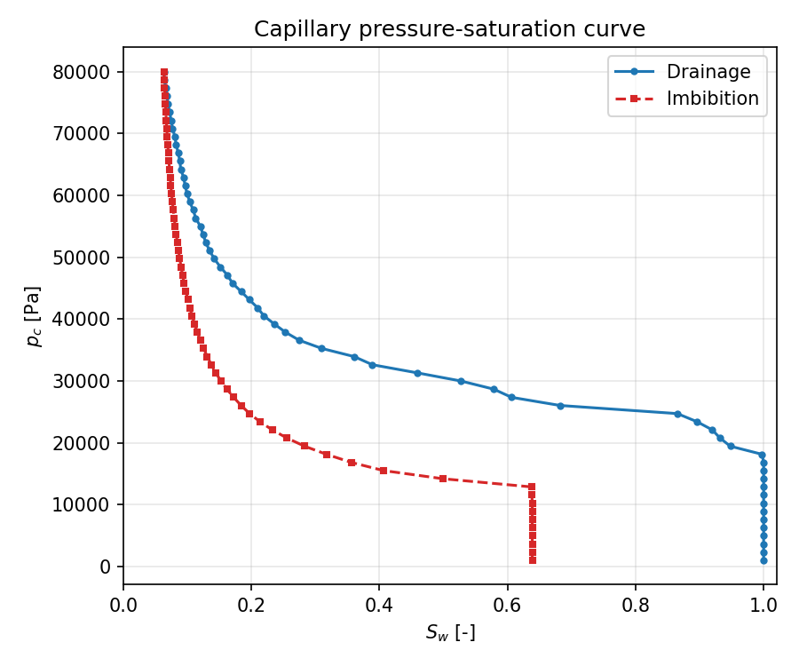
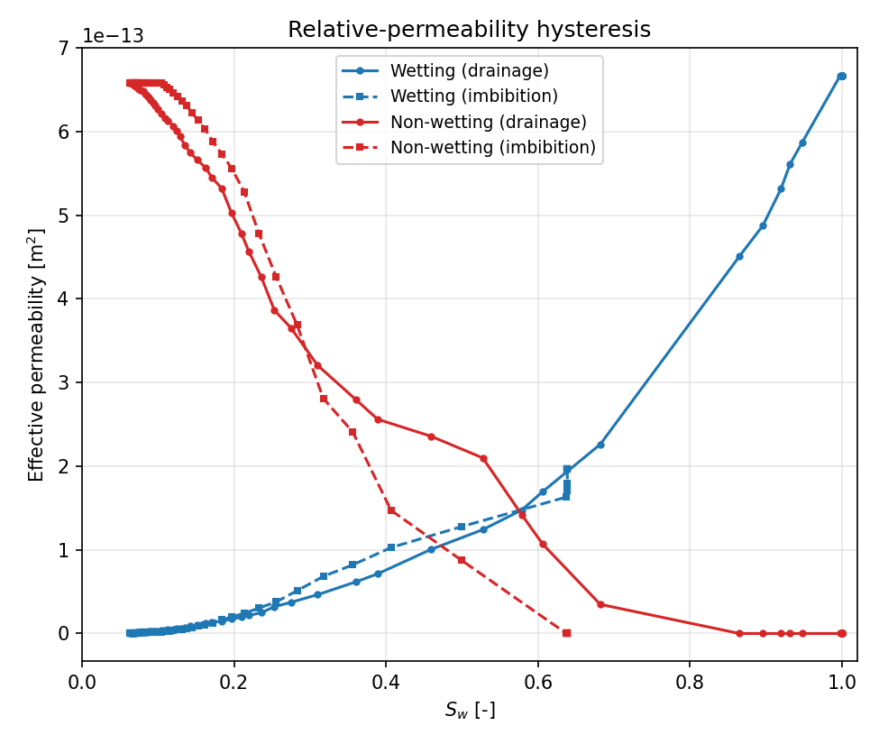
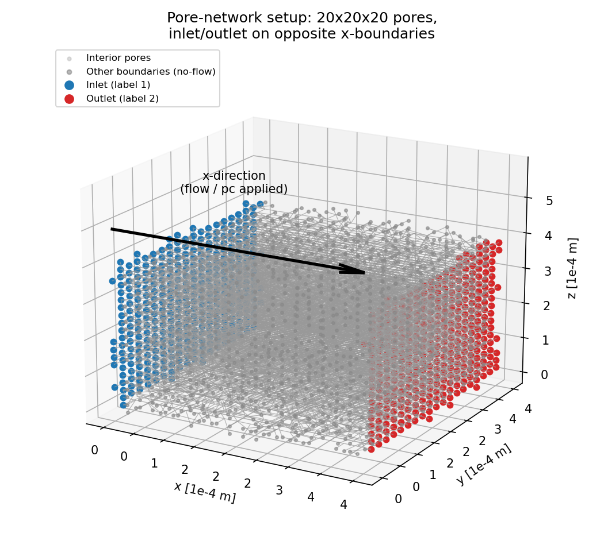
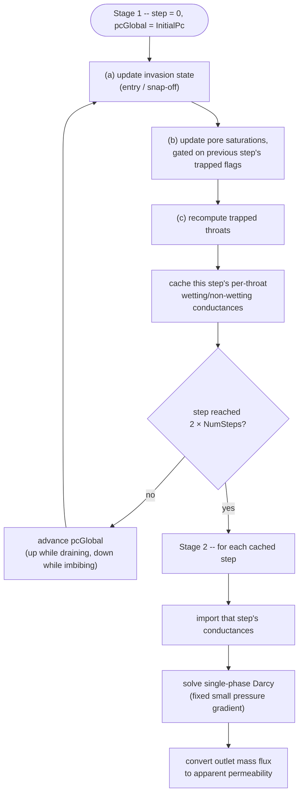
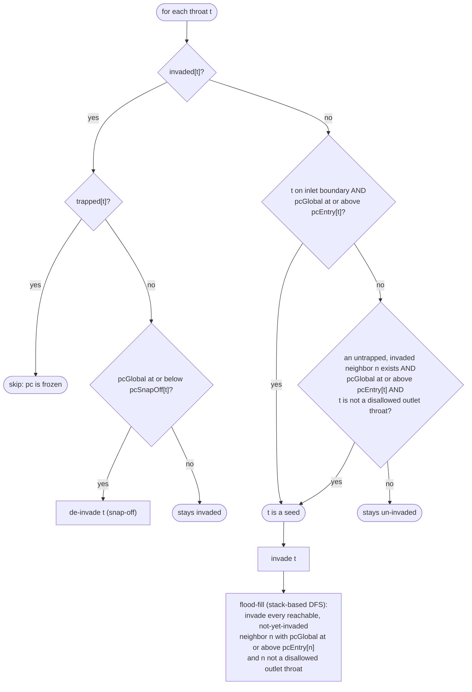
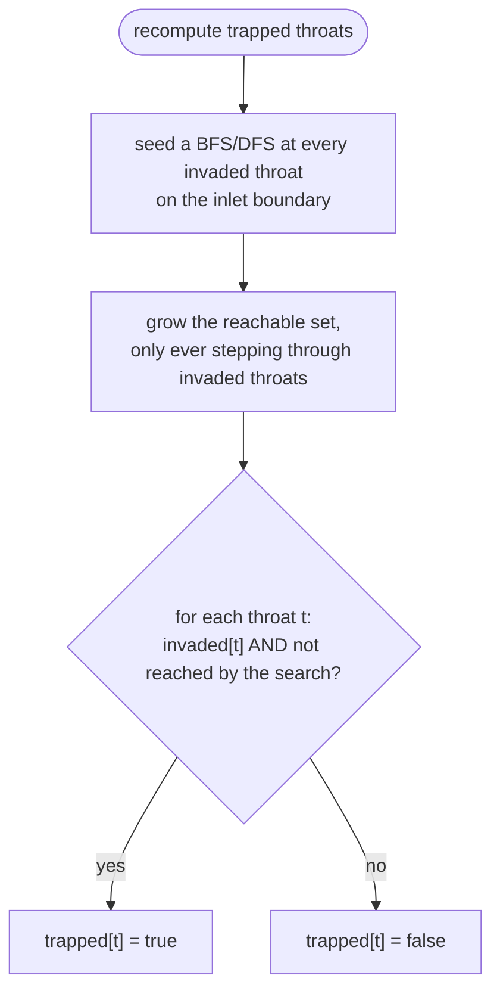
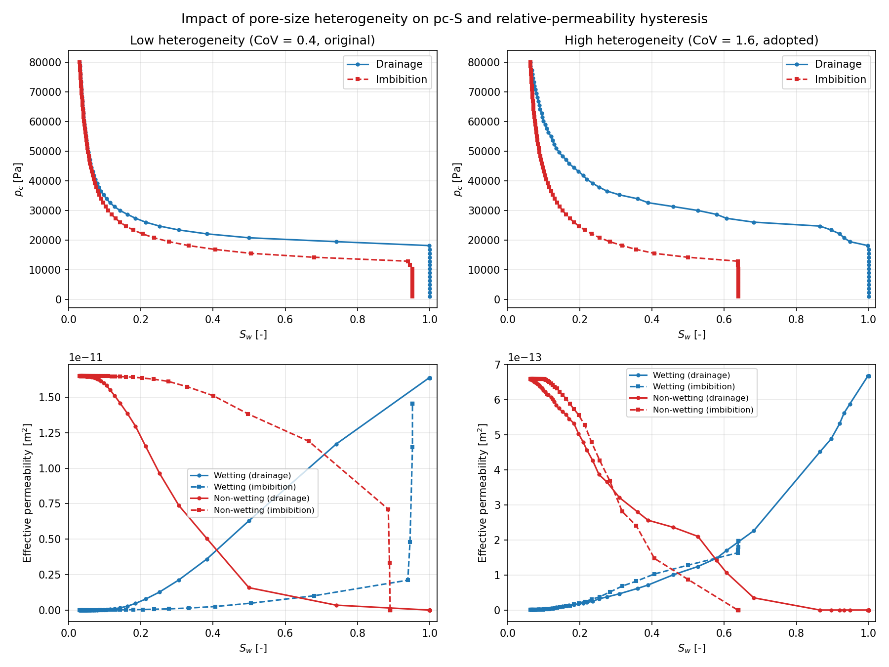

<!-- Important: This file has been automatically generated by generate_example_docs.py. Do not edit this file directly! -->

# Upscaling two-phase relative permeability with a pore network

__In this example, you will learn how to__

* drive a pore network through a full drainage-imbibition capillary-pressure cycle (invasion percolation with snap-off and non-wetting-phase trapping)
* use the resulting per-step, per-throat phase conductances to upscale **relative permeability** via a sequence of single-phase Darcy solves, one per fluid and per saturation step
* see how the pore network's **heterogeneity** (the breadth of its pore-size distribution) controls how much non-wetting-phase trapping -- and hence how much relative-permeability hysteresis -- the upscaled curves show

__Result__.
Running the simulation produces a capillary pressure-saturation ($`p_c`$-$`S_w`$) hysteresis loop (Fig. 1) and, from it, upscaled relative-permeability curves for both phases (Fig. 2). Because some non-wetting phase becomes trapped during imbibition, the wetting phase recovers its single-phase permeability at a lower saturation on the imbibition leg than it lost it on drainage, and the non-wetting phase's relative permeability does not return all the way to zero.

<figure>
    <center>
        
        <figcaption> <b> Fig.1 </b> - Capillary pressure-saturation curve: drainage (blue) and imbibition (red). </figcaption>
    </center>
</figure>

<figure>
    <center>
        
        <figcaption> <b> Fig.2 </b> - Upscaled relative-permeability (here: effective permeability) curves, both phases, both legs. The imbibition legs end before S_w = 1 / S_w = 0: this gap is the residual (trapped) saturation. </figcaption>
    </center>
</figure>

After building the executable, run the simulation with `./example_pnm2p_upscaling`. The $`p_c`$-$`S_w`$ data is written to `pnm_2p_upscaling_pc-s-curve.txt`; the two relative-permeability data sets to `pnm_2p_upscaling_X-dir-<Wetting|Non-wetting>-EffPermeabilityVsAverageSaturation.dat`. If `Problem.PlotPcS = true` in `params.input` and Gnuplot is available, all three are plotted directly.

__Table of contents__. This description is structured as follows:

[[_TOC_]]


## Problem setup

We consider a randomly generated pore network (log-normally distributed pore radii, [randomly deleted throats](https://doi.org/10.1029/2010WR010180)) and use the sequence of invasion states obtained from a quasi-static two-phase sweep to upscale **relative permeability**. The network is a 20x20x20-pore cube with the inlet and outlet on opposite boundaries along the $`x`$-direction (Fig. 0); drainage/imbibition capillary pressure is applied globally across the network in stage 1, and the same $`x`$-direction is the one single-phase flow is driven through in stage 2.

<figure>
    <center>
        
        <figcaption> <b> Fig.0 </b> - The pore network: inlet pores (label 1, blue) and outlet pores (label 2, red) sit on opposite x-boundaries; all other boundaries are no-flow. </figcaption>
    </center>
</figure>

The simulation runs in two stages:

1. **Quasi-static two-phase sweep** (`runStaticProblem`, driven by `TwoPStatic`, see below for the invasion/snap-off/trapping algorithm itself). A full drainage-imbibition $`p_c`$ cycle is swept, and at every step the resulting per-throat wetting- and non-wetting-phase conductances are cached (they depend only on which throats are currently invaded/trapped, not on any pressure field, since this stage never actually solves for flow).
2. **Single-phase upscaling, once per fluid** (`runSinglePhaseUpscaling`). For each saturation step cached in stage 1, a single-phase `CreepingFlow` Darcy problem is solved on the pore network using that step's frozen conductances -- re-solving stage 1's network as if it only contained one fluid (whichever one is being upscaled), at that step's saturation state. The resulting mass flux is converted into an apparent permeability for that fluid at that saturation, exactly as in the [single-phase upscaling example](../porenetwork_upscaling/README.md), just repeated once per step of the cycle instead of once for the whole (single-phase) network.

Because both fluids are upscaled from the very same cached conductance sequence, their resulting curves share one consistent saturation axis, which is what makes plotting both $`k_{r,w}(S_w)`$ and $`k_{r,n}(S_w)`$ -- for both the drainage and imbibition legs -- on the same plot meaningful.

## Mathematical and numerical model

### Stage 1: invasion, snap-off and trapping

At each capillary-pressure step, throat-by-throat invasion percolation decides whether the non-wetting phase can enter a not-yet-invaded throat, or whether the wetting phase reconnects behind an already-invaded throat (snap-off):

* **Drainage (invasion).** A throat is invaded once the global capillary pressure $`p_{c,\text{global}}`$ reaches its entry (threshold) capillary pressure $`p_{c,\text{entry}}`$, *and* the throat is topologically connected to the inlet through already-invaded throats (or sits on the inlet boundary itself).
* **Imbibition (snap-off).** An already-invaded throat is de-invaded once $`p_{c,\text{global}}`$ drops to or below its snap-off capillary pressure $`p_{c,\text{snapoff}}`$ (Roof snap-off, driven by wetting-phase corner films).
* **Trapping.** Snap-off can disconnect part of the invaded cluster from the inlet -- the only true non-wetting-phase pressure source in this model. Once disconnected, that cluster's local capillary pressure can no longer respond to changes in $`p_{c,\text{global}}`$: it is *trapped*, and is excluded from further invasion and snap-off checks. This is what produces the residual non-wetting-phase saturation and the hysteresis between the drainage and imbibition legs of the $`p_c`$-$`S_w`$ curve, and hence of the upscaled relative-permeability curves.

The saturation of each pore body is obtained by inverting its own local $`p_c`$-$`S_w`$ relation (a closed-form expression for "platonic body" pore shapes, see `dumux/material/fluidmatrixinteractions/porenetwork/pore/2p`) at whatever capillary pressure it currently carries, and pore-volume-averaging over the network gives the network-averaged saturation reported in the $`p_c`$-$`S_w`$ curve. `TwoPStatic` (`dumux/porenetwork/2p/static/staticpnm.hh`) implements the invasion/snap-off/trapping logic described above.

#### Threshold capillary pressures

Both threshold pressures are Mayer-Stowe-Princen (MS-P)-type expressions evaluated from each throat's inscribed radius $`r`$, cross-sectional shape factor $`G`$ (drainage) or corner half-angle $`\beta`$ (snap-off), surface tension $`\sigma`$ and contact angle $`\theta`$; both are implemented in [`dumux/material/fluidmatrixinteractions/porenetwork/throat/thresholdcapillarypressures.hh`](../../dumux/material/fluidmatrixinteractions/porenetwork/throat/thresholdcapillarypressures.hh).

**Entry capillary pressure** (drainage). Following Mason and Morrow's MS-P theory as given in Eq. 11 of Rabbani et al. (2016)[^rabbani2016] (equivalently Eq. A-7 of Øren et al. (1998)[^oren1998]):

```math
D = \pi - 3\theta + 3\sin\theta\cos\theta - \frac{\cos^2\theta}{4G},
```
```math
F = \frac{1 + \sqrt{1 + \dfrac{4GD}{\cos^2\theta}}}{1 + 2\sqrt{\pi G}},
```
```math
p_{c,\text{entry}} = \frac{\sigma \cos\theta}{r}\left(1 + 2\sqrt{\pi G}\right) F .
```

**Snap-off capillary pressure** (imbibition), for a throat with regular cross section (equal corner half-angles $`\beta`$), Eq. 4.8 of Blunt (2017)[^blunt2017]:

```math
p_{c,\text{snapoff}} = \frac{\sigma}{r}\left(\cos\theta - \sin\theta \tan\beta\right),
```
valid only while $`\beta + \theta < \pi/2`$ (otherwise snap-off cannot occur and $`p_{c,\text{snapoff}} \to -\infty`$ is used so the throat never snaps off).

Symbols used above:

| Symbol | Meaning | Set from |
|---|---|---|
| $`p_{c,\text{entry}}`$ | entry (threshold) capillary pressure of a throat: the $`p_c`$ at which the non-wetting phase can first displace the wetting phase through it | computed, drives drainage |
| $`p_{c,\text{snapoff}}`$ | snap-off (threshold) capillary pressure of a throat: the $`p_c`$ at or below which the wetting phase reconnects and displaces the non-wetting phase back out | computed, drives imbibition |
| $`\sigma`$ | interfacial surface tension between the wetting and non-wetting phase | `Problem.SurfaceTension` |
| $`\theta`$ | contact angle | `Problem.ContactAngle` |
| $`r`$ | inscribed radius of the throat's cross section | pore-network geometry (`Grid` parameters) |
| $`G`$ | cross-sectional shape factor of the throat (area / perimeter$`^2`$; enters the entry-pressure formula only) | pore-network geometry, from `Grid.ThroatCrossSectionShape` |
| $`\beta`$ | corner half-angle of the throat's (regular) cross section (enters the snap-off formula only) | pore-network geometry, from `Grid.ThroatCrossSectionShape` |
| $`D`$, $`F`$ | dimensionless intermediate quantities of the MS-P entry-pressure formula (no independent physical meaning on their own) | computed from $`\theta`$, $`G`$ |

### Stage 2: single-phase upscaling

For a given fluid and saturation step, stage 2 solves the standard single-phase pore-network Darcy problem
```math
v_{ij} = g_{ij} \left( p_i - p_j \right),
```
with $`g_{ij}`$ the throat conductance imported, unchanged, from stage 1 (computed there from the Hagen-Poiseuille-type law used throughout DuMux's pore-network module, see the [single-phase upscaling example](../porenetwork_upscaling/README.md#mathematical-model)), under a fixed, small applied pressure gradient across the network (`Problem.MinimumPressureGradient`/`Problem.MaximumPressureGradient`, the smaller of the two is used: in the creeping-flow regime, the apparent permeability upscaled below is independent of the magnitude of the applied gradient, so one small sample is enough). The resulting mass flux $`Q`$ leaving the network's outlet gives the apparent permeability of that fluid at that saturation step, via Darcy's law for the representative elementary volume:
```math
k_{\text{app}} = \frac{Q\,\mu}{A}\,\frac{L}{\Delta p},
```
with $`\mu`$ the fluid's dynamic viscosity, $`A`$ the cross-sectional area and $`L`$ the length of the network in the upscaling direction (`Problem.Directions`), and $`\Delta p`$ the applied pressure drop. Not-yet-invaded (for the non-wetting phase) or already-de-invaded/trapped (for the wetting phase) throats are assigned a strongly reduced, but nonzero, placeholder conductance (`uninvadedNonWettingTransmissibilityFactor` in [`transmissibilityhelper.hh`](transmissibilityhelper.hh)) rather than exactly zero, which keeps the linear system well posed while still making that throat's contribution negligible.

Repeating this independently for every cached saturation step and for both fluids produces the two families of curves plotted in Fig. 2.

### Algorithm

**Workflow.** The driver loop in `main.cc` runs stage 1's full drainage-imbibition cycle, caching conductances at every step, then stage 2 once per fluid. Within stage 1, each step calls into `TwoPStatic` (`updateInvasionState`, then, after the saturation update, `updateTrappedState`) and then advances `pcGlobal` -- up while draining, back down while imbibing:



The ordering (a) &rarr; (b) &rarr; (c) within stage 1 matters: gating the saturation update (b) on the *previous* step's trapped flags lets a pore that becomes newly trapped in this very step still receive its last legitimate update before being frozen. Swapping (b) and (c) would silently discard that last increment.

**Per-throat invasion/snap-off decision.** This is the decision applied to every throat `t` at the current `pcGlobal`:



A trapped neighbor is deliberately excluded from the seed search (`Q5`): its non-wetting phase is disconnected from the inlet, so it must not be allowed to "restart" invasion elsewhere.

**Trapped-state connectivity search.** After the saturation update, every invaded throat that has lost its connected path back to the inlet is marked trapped:



## Why network heterogeneity matters

The pore network's breadth of pore sizes (`Grid.StandardDeviationPoreInscribedRadius` relative to `Grid.MeanPoreInscribedRadius`) turns out to control *how much* trapping -- and hence how much hysteresis -- the upscaled relative-permeability curves show.

$`p_{c,\text{snapoff}}`$ scales with $`1/r`$: wider throats have *lower* snap-off thresholds, narrower ones *higher* thresholds. If a network's pore sizes are drawn from a narrow distribution (low standard deviation relative to the mean, low coefficient of variation, CoV), nearly every throat's snap-off threshold clusters around the same value -- so as $`p_{c,\text{global}}`$ decreases during imbibition, almost the entire invaded cluster de-invades within a narrow window near the end of the sweep, essentially all at once, rather than gradually tracking the retreating front the way drainage invasion does. With little separation between thresholds, there is little opportunity for part of the cluster to become disconnected from the inlet before the rest follows -- so almost nothing gets *trapped*, hysteresis is minimal, and (as this example's own investigation found) the resulting relative-permeability ordering can even come out in the wrong direction relative to textbook expectations.

A sufficiently wide distribution (high CoV) instead gives the network a genuine spread of snap-off thresholds: some throats de-invade early (high $`p_c`$, large throats would be the ones to have *invaded* last and widest), others only much later (low $`p_c`$, narrow throats). This spread is what allows parts of the invaded cluster to become disconnected from the inlet -- genuinely trapped -- partway through the imbibition leg, rather than everything de-invading in lockstep at the very end.

Fig. 3 compares the same network and the same drainage-imbibition cycle, run with a narrow pore-size distribution (`StandardDeviationPoreInscribedRadius = 0.4` $`\times`$ the mean, left column) against this example's adopted, wide distribution (`= 1.6` $`\times`$ the mean, right column, the value shipped in [`params.input`](params.input)):

<figure>
    <center>
        
        <figcaption> <b> Fig.3 </b> - Top row: p_c-S_w curves; bottom row: relative-permeability curves. Left: low heterogeneity (CoV = 0.4) -- drainage and imbibition legs sit close together, residual trapping is negligible, and the wetting/non-wetting curves cross in a non-textbook order. Right: high heterogeneity (CoV = 1.6, adopted here) -- a visible gap opens between the two legs, residual non-wetting saturation appears (the imbibition kr legs stop well short of S_w = 0), and the ordering matches textbook expectations (kr,n on imbibition below kr,n on drainage at matching S_w). </figcaption>
    </center>
</figure>

In practice this means `Grid.StandardDeviationPoreInscribedRadius` is not just a cosmetic network-generation knob here -- it determines whether the upscaled hysteresis loop is physically meaningful at all. Pushing the heterogeneity too far in the other direction is also undesirable: an excessively wide distribution leaves too many throats with very high snap-off thresholds, so an unrealistically large fraction of the non-wetting phase never gets displaced again, inflating the residual saturation beyond what the chosen value (CoV = 1.6) was found to give.

[^rabbani2016]: Rabbani, H.S., Joekar-Niasar, V., Shokri, N. (2016). *Effects of intermediate wettability on entry capillary pressure in angular pores.* Journal of Colloid and Interface Science, 473, 34-43. Eq. 11. https://doi.org/10.1016/j.jcis.2016.03.053
[^oren1998]: Øren, P.E., Bakke, S., Arntzen, O.J. (1998). *Extending Predictive Capabilities to Network Models.* SPE Journal, 3(4), 324-336. Eq. A-7. https://doi.org/10.2118/52052-PA
[^blunt2017]: Blunt, M.J. (2017). *Multiphase Flow in Permeable Media: A Pore-Scale Perspective.* Cambridge University Press. Eq. 4.8. https://doi.org/10.1017/9781316145098

# Implementation & Post processing

In the following, we take a closer look at the source files for this example.

```
└── porenetwork_upscaling_twophase/
    ├── CMakeLists.txt             -> build system file
    ├── main.cc                    -> main program flow
    ├── params.input                -> runtime parameters
    ├── properties.hh               -> compile-time (TypeTag) model configuration
    ├── problem_static.hh           -> stage 1: quasi-static two-phase sweep problem
    ├── problem_singlephase.hh      -> stage 2: single-phase upscaling problem
    ├── spatialparams.hh            -> spatial parameters (shared with the single-phase upscaling example)
    ├── transmissibilityhelper.hh   -> imports stage 1's cached conductances into stage 2's flux law
    └── upscalinghelper.hh          -> saturation bookkeeping, permeability conversion, plotting
```

## Part 1: Main program flow

| [:arrow_right: Click to continue with part 1 of the documentation](doc/main.md) |
|---:|


## Part 2: Postprocessing/Visualization of a pore-network model

| [:arrow_right: Click to continue with part 2 of the documentation](doc/postprocessing.md) |
|---:|
