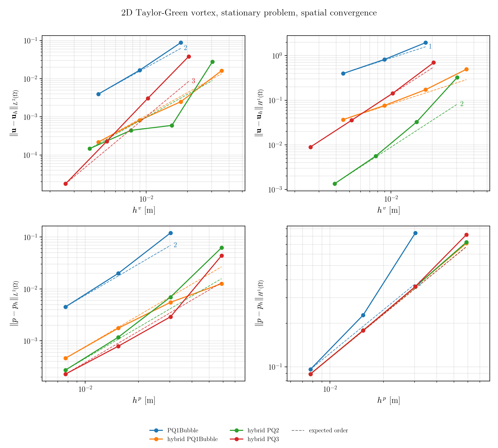
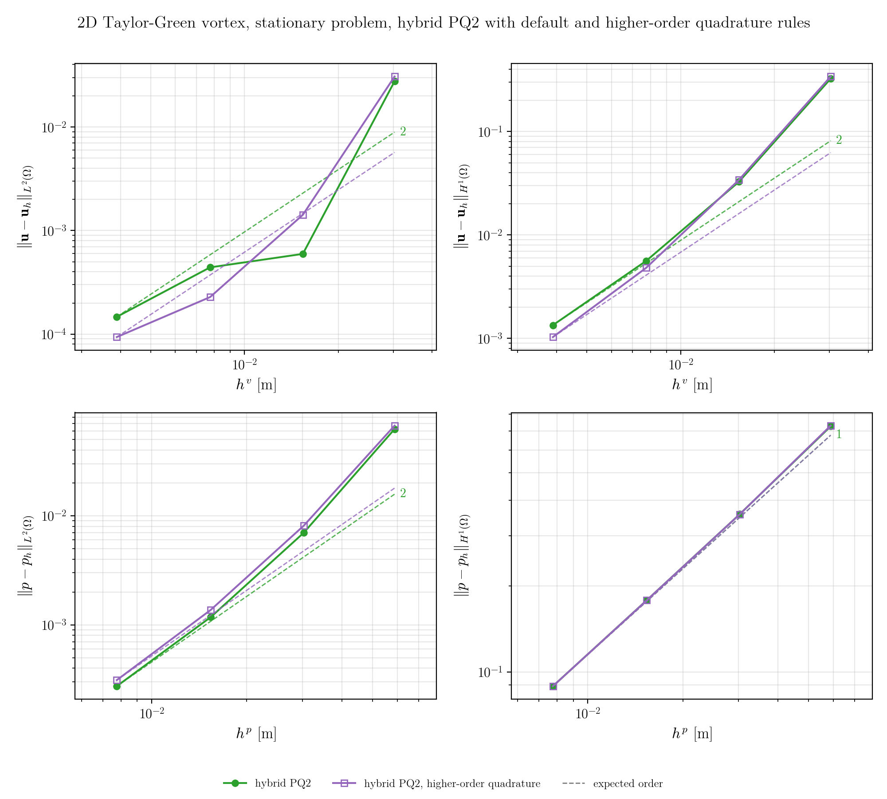
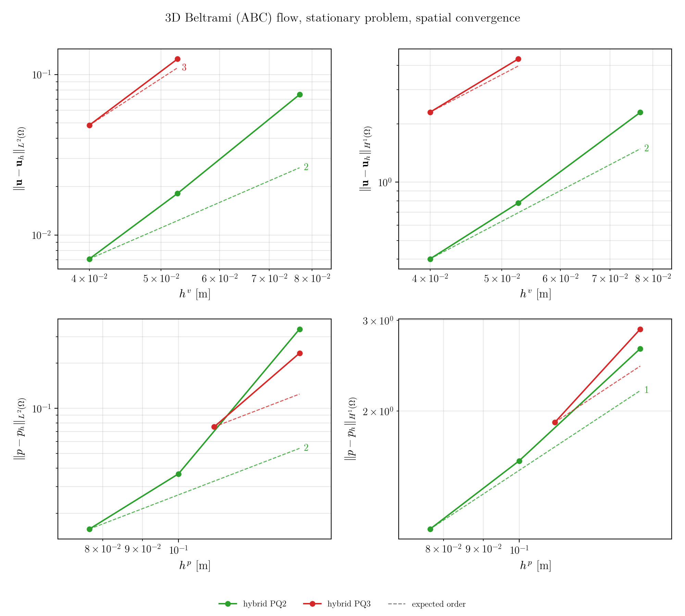
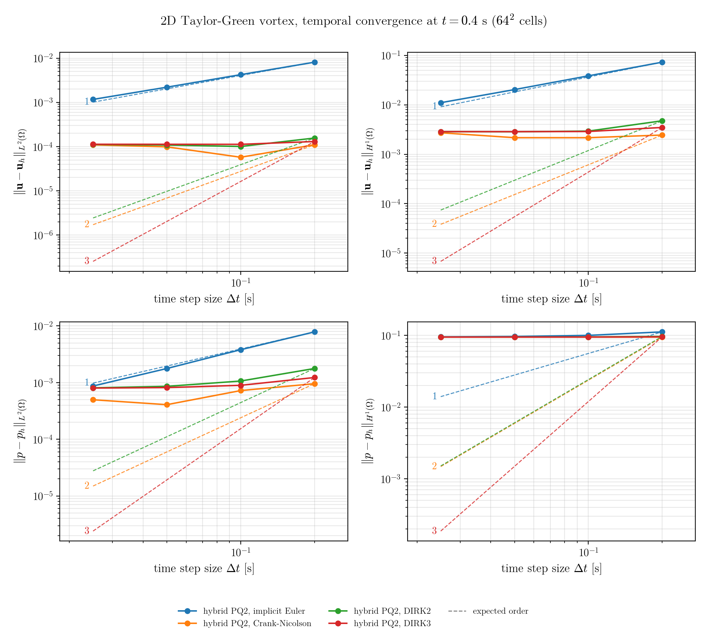
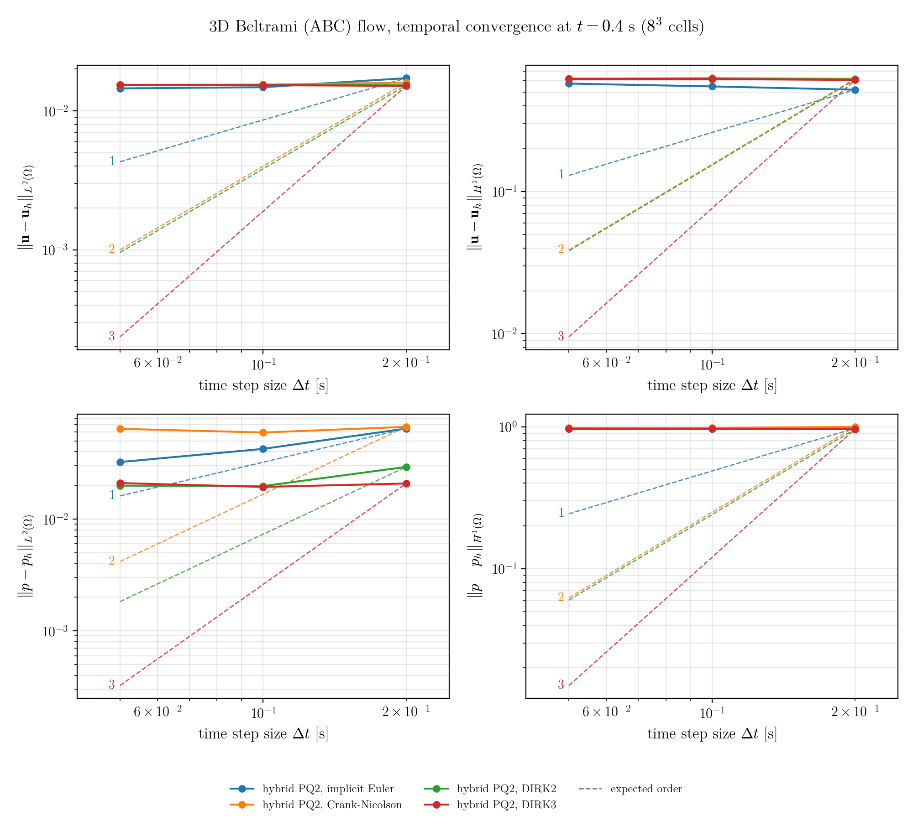
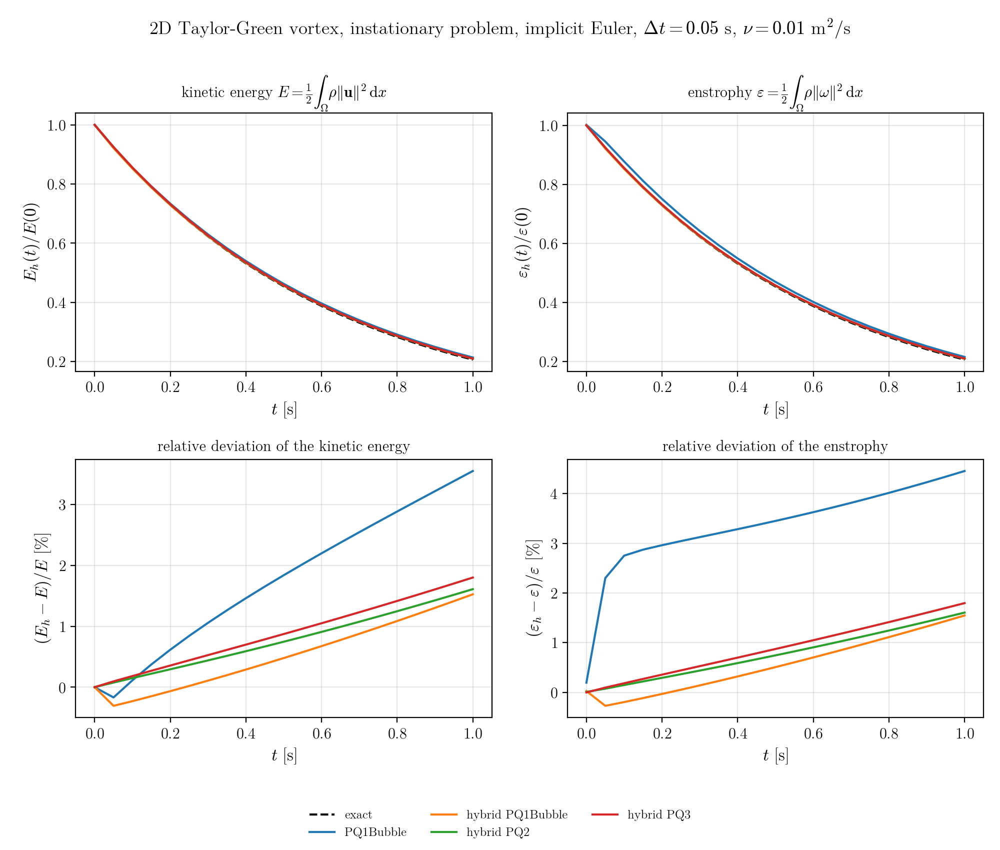
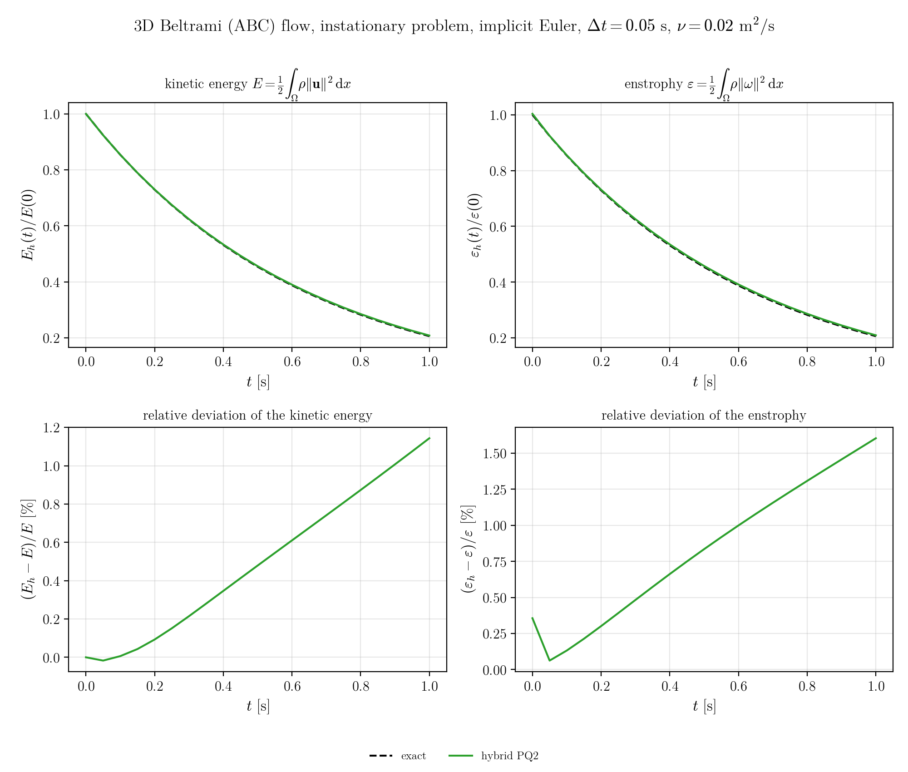

# Taylor-Green vortex {#benchmark-taylor-green-vortex}

This benchmark compares the spatial and temporal discretization schemes for the incompressible
Navier-Stokes equations available in DuMu<sup>x</sup> against two exact solutions:

* **2D**: the Taylor-Green vortex,
* **3D**: a Beltrami (ABC) flow.

Both solutions are spatially periodic and decay exponentially in time.

## Problem description

### Governing equations

The incompressible Navier-Stokes equations read

$$
\begin{align*}
\rho \frac{\partial \mathbf{u}}{\partial t} + \nabla \cdot (\rho \mathbf{u} \otimes \mathbf{u})
- \nabla \cdot (\mu \nabla \mathbf{u}) + \nabla p &= \mathbf{f}, \\
\nabla \cdot \mathbf{u} &= 0,
\end{align*}
$$

| Symbol | Meaning |
|--------|---------|
| $\mathbf{u} = (u, v[, w])$ | velocity |
| $p$ | pressure |
| $\rho$ | density |
| $\mu = \rho \nu$, $\nu$ | dynamic and kinematic viscosity |
| $\mathbf{f}$ | source term (zero for the instationary Navier-Stokes problem) |

The viscous term is discretized in the form $\nabla \cdot (\mu \nabla \mathbf{u})$
(`FreeFlow.EnableUnsymmetrizedVelocityGradient = true`). For $\nabla \cdot \mathbf{u} = 0$ and constant $\mu$,
it equals the symmetrized form $\nabla \cdot (\mu (\nabla \mathbf{u} + \nabla \mathbf{u}^T))$, which is used with
`FreeFlow.EnableUnsymmetrizedVelocityGradient = false`.

### Construction of the solutions

Both solutions belong to the class of solutions described by Ethier & Steinman @cite EthierSteinman1994,
summarized in Antuono @cite Antuono2020 (Section 2):

* the velocity is divergence free,
* the time derivative balances the viscous term, $\rho \partial_t \mathbf{u} = \nabla \cdot (\mu \nabla \mathbf{u})$,
  so the solution decays exponentially in time,
* the convective term is a gradient (generalized Beltrami flow), $\nabla \cdot (\rho \mathbf{u} \otimes \mathbf{u}) = -\nabla p$,
  so it is balanced by the pressure alone.

Hence, the solutions are exact for any amplitude and viscosity. They are periodic in every direction with the
wavelength $L$, i.e. with the wave number $k = 2\pi / L$.

### Two-dimensional case: Taylor-Green vortex

The bi-periodic solution of Taylor @cite Taylor1923Decay (in the form of Antuono @cite Antuono2020, Section 2.1,
scaled with the amplitude $U_0$) is an array of counter-rotating vortices:

$$
\begin{align*}
u(x, y, t) &= -U_0 \cos(k x) \sin(k y) F(t), \\
v(x, y, t) &= U_0 \sin(k x) \cos(k y) F(t), \\
p(x, y, t) &= -\frac{\rho U_0^2}{4} \left( \cos(2 k x) + \cos(2 k y) \right) F^2(t),
\end{align*}
$$

* decay factor: $F(t) = e^{-2 \nu k^2 t}$,
* vorticity (a scalar): $\omega = \partial_x v - \partial_y u = 2 k U_0 \cos(k x) \cos(k y) F(t)$.

This solution is due to Taylor (1923) alone. Taylor & Green @cite Taylor1937 studied the evolution of a
three-dimensional initial condition, for which no closed-form solution is known.

### Three-dimensional case: Beltrami (ABC) flow

The tri-periodic Beltrami flow of Barbato, Berselli & Grisanti @cite Barbato2007 (Eq. (2.9) in
Antuono @cite Antuono2020), also known as Arnold-Beltrami-Childress (ABC) flow, reads

$$
\begin{align*}
u(x, y, z, t) &= \left( A \sin(k z) + C \cos(k y) \right) F(t), \\
v(x, y, z, t) &= \left( B \sin(k x) + A \cos(k z) \right) F(t), \\
w(x, y, z, t) &= \left( C \sin(k y) + B \cos(k x) \right) F(t), \\
p(x, y, z, t) &= -\rho \left( B C \cos(k x) \sin(k y) + A B \sin(k x) \cos(k z) + A C \sin(k z) \cos(k y) \right) F^2(t),
\end{align*}
$$

* amplitudes: $A, B, C$ (arbitrary),
* decay factor: $F(t) = e^{-\nu k^2 t}$,
* vorticity: parallel to the velocity, $\boldsymbol{\omega} = \nabla \times \mathbf{u} = k \mathbf{u}$.

Remarks:

* The pressure equals $-\frac{\rho}{2} \|\mathbf{u}\|^2$ up to the time-dependent constant
  $\frac{\rho}{2} (A^2 + B^2 + C^2) F^2(t)$.
* The flow is not fully three-dimensional, since every velocity component is independent of the corresponding
  coordinate ($\partial_x u = \partial_y v = \partial_z w = 0$). Fully three-dimensional tri-periodic solutions are
  given by Antuono @cite Antuono2020 (Section 3).

### Variants and source terms

The instationary Navier-Stokes problem uses **no source term**. The other variants omit a term of the
Navier-Stokes equations, which is therefore added as source term, evaluated with the analytical solution. With the
two identities above, all source terms are closed-form expressions in the analytical velocity and pressure:

| Variant | Navier-Stokes | Stokes (`Problem.EnableInertiaTerms = false`) |
|---------|---------------|-----------------------------------------------|
| instationary (`Problem.IsStationary = false`) | $\mathbf{f} = \mathbf{0}$ | $\mathbf{f} = -\nabla \cdot (\rho \mathbf{u} \otimes \mathbf{u}) = \nabla p$ |
| stationary (`Problem.IsStationary = true`) | $\mathbf{f} = -\rho \partial_t \mathbf{u} = \lambda \mu \mathbf{u}$ | $\mathbf{f} = \lambda \mu \mathbf{u} + \nabla p$ |

* $\lambda = 2 k^2$ in 2D and $\lambda = k^2$ in 3D.
* The stationary variant is the solution at $t = 0$ ($F \equiv 1$): it adds the **storage term**.
* The Stokes variant adds the **convective term**.

### Initial and boundary conditions

Apart from the source terms, the analytical solution is only used for the initial and boundary conditions and the
errors:

* **Initial condition**: the $L^2$ projection of the analytical solution at $t = 0$ onto the discrete spaces. It is
  also the initial guess of the Newton solver for the stationary problem.
* **Velocity**: the analytical velocity is prescribed as Dirichlet condition on the entire boundary, evaluated at the
  current time (and at the stage times of the multi-stage methods).
* **Pressure**: since the velocity is prescribed on the entire boundary, the pressure is only determined up to a
  constant. It is therefore fixed to its analytical value at a single degree of freedom (the Box control volume of
  the vertex at the lower left corner).

Due to the periodicity of the solutions, periodic boundary conditions on a domain of an integer number of
wavelengths would be the natural choice. They are not yet supported for the control-volume finite-element schemes
in the coupled free-flow setup.

## Discretization

### Momentum and mass balance

The mass balance is always discretized with the Box scheme (@ref BoxDiscretization). The momentum balance is
discretized with the following control-volume finite-element schemes:

| Scheme | Name | Grid | Remarks |
|--------|------|------|---------|
| PQ1Bubble (@ref PQ1BubbleDiscretization) | `pq1bubble` | simplices (`Dune::ALUGrid`) | one bubble per element, with the Box pressure only inf-sup stable on simplices |
| hybrid PQ1Bubble | `pq1bubblehybrid` | cubes (`Dune::YaspGrid`) | |
| hybrid PQ2 | `pq2hybrid` | cubes | |
| hybrid PQ2, higher-order quadrature | `pq2hybridhoquad` | cubes | see below |
| hybrid PQ3 | `pq3hybrid` | cubes | |

* In the hybrid schemes, only the vertex degrees of freedom have control volumes (the sub-control volumes of the
  Box scheme). The balance equations of the edge, face and element degrees of freedom are discretized with finite
  elements.
* In 3D, the Newton solver does not converge with PQ1Bubble and hybrid PQ1Bubble. Their executables are built,
  but they are not tested and not part of the default 3D studies.
* The new CVFE problem interface is used (see also the tests `donea` and `sincos`).

### Quadrature rules

* The integrals are evaluated with the default quadrature rules of the schemes:
  * hybrid PQ2: midpoint rule on the sub-control volumes (only second-order consistent for a non-polynomial
    source), Gauss rule of order 2 on the sub-control-volume faces, order 4 for the finite-element terms;
  * hybrid PQ3: Gauss rules of order 3 for the sub-control volumes and faces, order 6 for the elements.
* `pq2hybridhoquad` checks whether the default rules of hybrid PQ2 are accurate enough. It uses a Gauss rule of
  order 3 on the sub-control volumes (`PQ2QuadratureTraits`) and of order 2 for the mass fluxes over the
  sub-control-volume faces of the Box scheme (`BoxQuadratureTraits`).
* The storage terms are lumped in all schemes (independent of the quadrature rules), which limits the spatial order
  of the instationary problem to 2.
* The errors and indicators are computed with a quadrature rule of order 8. For order 5, the quadrature error of
  the error norm of the higher-order schemes is of the same order as the error itself.

### Convective flux

* The convective flux over a sub-control-volume face transports the weighted two-point velocity
  $\zeta \mathbf{u}_\mathrm{up} + (1 - \zeta) \mathbf{u}_\mathrm{down}$ of the two adjacent sub-control volumes
  (`advectiveMomentumFlux` in `dumux/freeflow/navierstokes/momentum/cvfe/flux.hh`).
* The upwind weight is $\zeta$ = `Flux.UpwindWeight` $= 0.5$ (central, two-point average) in all studies and tests.
  Full upwinding ($\zeta = 1$) is only first-order accurate and adds numerical diffusion that visibly damps the
  vortex.
* The two-point average does not use the finite-element interpolant of the velocity at the face, which may limit
  the convergence order of the higher-order schemes. Possible remedies (not implemented yet):
  * evaluate the convected velocity with the finite-element interpolant at the integration points of the faces
    (as in the central scheme of the CVFEM in Nalu @cite Domino2018),
  * linear upwinding with consistently projected nodal gradients,
  * a deferred correction approach.

### Time integration

* The instationary problem is integrated with the multi-stage methods implicit Euler (default), Crank-Nicolson,
  DIRK2 and DIRK3 (`TimeLoop.Scheme`, see @ref benchmark-timestepping-methods) with a constant time step size.
* The multi-stage multi-domain assembler does not implement the assembly of the residual alone, so the Newton
  solver only uses the shift criterion (`Newton.EnableAbsoluteResidualCriterion = false`,
  `Newton.SatisfyResidualAndShiftCriterion = false`).
* The stationary problem is solved with the standard multi-domain assembler.

## Parameters

| Parameter | Symbol | Value (2D) | Value (3D) | Unit | Input parameter |
|-----------|--------|------------|------------|------|-----------------|
| Domain | $\Omega$ | $[0, 1]^2$ | $[0, 1]^3$ | m | `Grid.UpperRight` |
| Grid | | $32 \times 32$ | $8 \times 8 \times 8$ | - | `Grid.Cells` |
| Wavelength | $L$ | $1$ | $1$ | m | `Problem.WaveLength` (default: domain length in $x$ direction) |
| Wave number | $k = 2\pi/L$ | $2\pi$ | $2\pi$ | 1/m | |
| Amplitude(s) | $U_0$; $A, B, C$ | $1$ | $1, 1, 1$ | m/s | `Problem.ReferenceVelocity`; `Problem.A`, `Problem.B`, `Problem.C` |
| Root mean square velocity | $U = \left( \frac{1}{\|\Omega\|} \int_\Omega \|\mathbf{u}(\mathbf{x}, 0)\|^2 \, \mathrm{d}x \right)^{1/2}$ | $U_0/\sqrt{2} \approx 0.71$ | $\sqrt{A^2 + B^2 + C^2} \approx 1.73$ | m/s | |
| Density | $\rho$ | $1$ | $1$ | kg/m³ | `Component.LiquidDensity` |
| Kinematic viscosity | $\nu$ | $0.01$ | $0.02$ | m²/s | `Component.LiquidKinematicViscosity` |
| Reynolds number | $Re = U L / \nu$ | $71$ | $87$ | - | |
| End time | $T$ | $1$ | $1$ | s | `TimeLoop.TEnd` |
| Time step size | $\Delta t$ | $0.05$ | $0.05$ | s | `TimeLoop.DtInitial` |
| Time integration | | implicit Euler | implicit Euler | - | `TimeLoop.Scheme` |
| Decay factor at end time | $F(T)$ | $0.45$ | $0.45$ | - | |

* The parameters are set in `params_2d.input` and `params_3d.input`.
* In 3D, $\nu = 0.02$ is used since the Newton solver does not converge for the stationary problem on the coarse 3D
  grids with $\nu = 0.01$. The decay over the simulated time then equals the one of the 2D case.

## Benchmark indicators

All indicators are evaluated by quadrature (order 8) for the numerical solution $\mathbf{u}_h$, $p_h$ and the
analytical solution, and written for every time step to the error file (`Problem.ErrorFile`, default
`<Problem.Name>_errors.csv`).

### Vorticity, kinetic energy and enstrophy

| Indicator | Definition |
|-----------|------------|
| Vorticity | $\omega = \partial_x v - \partial_y u$ (a scalar) in 2D, $\boldsymbol{\omega} = \nabla \times \mathbf{u}$ in 3D |
| Kinetic energy | $E(t) = \frac{1}{2} \int_\Omega \rho \|\mathbf{u}\|^2 \, \mathrm{d}x$ |
| Enstrophy | $\boldsymbol{\varepsilon}(t) = \frac{1}{2} \int_\Omega \rho \|\boldsymbol{\omega}\|^2 \, \mathrm{d}x$ |

* The vorticity of the numerical solution is evaluated with the gradient of the finite-element interpolant
  $\mathbf{u}_h$ (discontinuous across elements). It is also written to the ParaView output: at the element centers
  in the standard output and in the higher-order output.
* For an incompressible flow with periodic (or no-slip) boundaries, the kinetic energy is dissipated by viscosity at
  the rate $-\frac{\mathrm{d}E}{\mathrm{d}t} = 2 \nu \boldsymbol{\varepsilon}$.
* If $\Omega$ consists of an integer number of wavelengths in each direction (one wavelength by default), the
  analytical values are

  | | $E(t)$ | $\boldsymbol{\varepsilon}(t)$ |
  |-|--------|-------------------------------|
  | 2D | $\frac{1}{4} \rho U_0^2 \|\Omega\| F^2(t)$ | $2 k^2 E(t)$ |
  | 3D | $\frac{1}{2} \rho (A^2 + B^2 + C^2) \|\Omega\| F^2(t)$ | $k^2 E(t)$ |

  and the analytical solutions satisfy the energy balance $-\frac{\mathrm{d}E}{\mathrm{d}t} = 2 \nu \boldsymbol{\varepsilon}$.
* For the numerical solution, the Dirichlet boundaries add boundary terms (the energy flux through $\partial \Omega$)
  and the time integration adds numerical dissipation.
* The solutions, the identities behind the source terms and these formulas are verified symbolically by `verify.py`.

### Spatial convergence (stationary variant)

* Errors of velocity and pressure in the $L^2$ norm and the (full) $H^1$ norm,
  $\|\mathbf{u} - \mathbf{u}_h\|_{L^2(\Omega)}$, $\|\mathbf{u} - \mathbf{u}_h\|_{H^1(\Omega)}$,
  $\|p - p_h\|_{L^2(\Omega)}$, $\|p - p_h\|_{H^1(\Omega)}$, with
  $\|v\|_{H^1(\Omega)}^2 = \|v\|_{L^2(\Omega)}^2 + \|\nabla v\|_{L^2(\Omega)}^2$.
* The experimental orders of convergence (EOC) under uniform grid refinement are computed, as in
  @cite Schneider2024, with respect to the mesh sizes of velocity and pressure,
  $$
  h^v = \left( \frac{|\Omega|}{N_v} \right)^{1/d}, \qquad h^p = \left( \frac{|\Omega|}{N_p} \right)^{1/d}.
  $$
  $N_v$ and $N_p$ are the numbers of velocity and pressure degrees of freedom (nodes, not counting the velocity
  components; including bubble, edge and element degrees of freedom). This allows comparing schemes with different
  element types and numbers of degrees of freedom per element.

Expected orders:

| Momentum scheme | $\|\mathbf{u} - \mathbf{u}_h\|_{L^2(\Omega)}$ | $\|\mathbf{u} - \mathbf{u}_h\|_{H^1(\Omega)}$ | $\|p - p_h\|_{L^2(\Omega)}$ (Box) | $\|p - p_h\|_{H^1(\Omega)}$ (Box) |
|-----------------|---|---|---|---|
| PQ1Bubble | 2 | 1 | 2 | 1 |
| hybrid PQ1Bubble | 2 | 1 | 2 | 1 |
| hybrid PQ2 (default quadrature) | 2 | 2 | 2 | 1 |
| hybrid PQ2 (higher-order quadrature) | 2 | 2 | 2 | 1 |
| hybrid PQ3 | 3 | 2 | 2 | 1 |

* The Box pressure (P1/Q1) only converges with order 2, so the velocity of the hybrid schemes converges at most
  with order 2 in $H^1$ and 3 in $L^2$ (the schemes are not pressure-robust). Hybrid PQ3 is therefore not expected
  to reach the order 4 of a cubic interpolation (cf. the remark on P3-P1 in
  `test/freeflow/navierstokes/channel/3d_nonuniform`).
* The reduced velocity $L^2$ order 2 of hybrid PQ2 is a property of the hybrid P2 scheme itself (according to the
  developers of the hybrid schemes, due to cancellations in the integration), which hybrid PQ3 does not have.

### Temporal convergence (instationary variant)

* The errors at $t = T$ on a fine grid under refinement of the time step size.
* Expected orders: 1 (implicit Euler), 2 (Crank-Nicolson, DIRK2), 3 (DIRK3).

## Results

The results were obtained with `benchmark.py` using the default settings (`--study spatial temporal energy` in 2D
and 3D, `--study animation` in 2D), plotted with `visualize.py` and animated with `animate.py`. The figures and the
videos are stored in the directory `results/`.

### Spatial convergence in 2D

Setup: stationary problem, $16^2$ to $128^2$ cells ($32^2$ to $128^2$ cells for PQ1Bubble, for which the Newton
solver does not converge on $16^2$ cells).

| Scheme | velocity $L^2$ EOC | velocity $H^1$ EOC (finest) | pressure $L^2$ EOC (finest) |
|--------|--------------------|-----------------------------|-----------------------------|
| PQ1Bubble | 2.42, 2.08 | 1.05 | 2.17 |
| hybrid PQ1Bubble | 2.74, 1.63, 1.90 | 1.06 | 1.94 |
| hybrid PQ2 | 5.66, 0.44, 1.60 | 2.08 | 2.13 |
| hybrid PQ2, higher-order quadrature | 4.54, 2.67, 1.29 | 2.24 | 2.16 |
| hybrid PQ3 | 3.70, 3.78, 3.72 | 2.00 | 1.80 |

* PQ1Bubble and hybrid PQ1Bubble reach the expected orders.
* Hybrid PQ3 converges with order 3.7 in the velocity $L^2$ error and 2 in the velocity $H^1$ error.
* Hybrid PQ2 converges with order 2 in the velocity $H^1$ error, but only irregularly in the velocity $L^2$ error.
  This norm is therefore not checked by the convergence tests.
* The pressure converges with order 2 in $L^2$ and 1 in $H^1$ for all schemes.



The higher-order quadrature rules change the velocity $L^2$ error of hybrid PQ2 on the individual grids, but neither
its irregular convergence nor the other error norms, i.e. the default quadrature rules are sufficient:



### Spatial convergence in 3D

Setup: stationary problem, $6^3$ to $12^3$ cells ($6^3$ and $8^3$ cells for hybrid PQ3), Newton solver with line
search.

| Scheme | velocity $L^2$ EOC | velocity $H^1$ EOC |
|--------|--------------------|--------------------|
| hybrid PQ2 | 3.74, 3.42 | 2.83, 2.42 |
| hybrid PQ3 | 3.46 | 2.31 |

* On these coarse grids, the errors are not yet in the asymptotic regime.
* Hybrid PQ3 has larger errors than hybrid PQ2 for the same number of degrees of freedom.
* As in 2D, the higher-order quadrature rules hardly change the errors of hybrid PQ2
  ([figure](results/taylorgreen_spatial_3d_quadrature.png)).



### Temporal convergence in 2D

Setup: instationary problem, $64^2$ cells, hybrid PQ2, $t = 0.4$ s. The expected slopes are drawn through the errors
of the largest time step size, since on smaller time step sizes the spatial error dominates.

* Implicit Euler converges with an order of about 0.9 in the velocity errors and in the pressure $L^2$ error.
* For Crank-Nicolson, DIRK2 and DIRK3, the velocity error ($\approx 1.1 \cdot 10^{-4}$ in $L^2$) is already for the
  largest time step size dominated by the spatial error. Their temporal orders cannot be observed with the error
  against the analytical solution.
* The pressure $H^1$ error is dominated by the spatial error for all methods.



### Temporal convergence in 3D

Setup: instationary problem, $8^3$ cells (limited by the direct linear solver), hybrid PQ2, $t = 0.4$ s.

* The spatial error ($\approx 1.5 \cdot 10^{-2}$ in the velocity $L^2$ norm) dominates the temporal error of all
  methods already for the largest time step size, so no temporal orders can be observed with the error against the
  analytical solution.
* Only the pressure $L^2$ error of implicit Euler decreases noticeably (EOC 0.6, 0.4).



### Kinetic energy and enstrophy in 2D

Setup: instationary problem, $32^2$ cells, $\Delta t = 0.05$ s, implicit Euler.

| Scheme | $(E_h - E)/E$ at $t = 1$ s | $(\boldsymbol{\varepsilon}_h - \boldsymbol{\varepsilon})/\boldsymbol{\varepsilon}$ at $t = 1$ s |
|--------|----------------------------|------------------------------------------------------------------------------------------------|
| PQ1Bubble | 3.5 % | 4.5 % |
| hybrid schemes | 1.5-1.8 % | 1.5-1.8 % |

* The deviation is dominated by the temporal error: in a periodic domain, the implicit Euler method alone
  overestimates the energy at $t = 1$ s by 3.1 %.
* With $\Delta t = 0.01$ s (as in the animation), the deviation of hybrid PQ3 reduces to 0.7 % (0.6 % predicted for
  the implicit Euler method).
* Hybrid PQ2 with higher-order quadrature rules is not shown, since its kinetic energy and enstrophy coincide with
  those of hybrid PQ2 (relative difference below $10^{-5}$).



### Kinetic energy and enstrophy in 3D

Setup: instationary problem, $8^3$ cells, $\Delta t = 0.05$ s, implicit Euler, hybrid PQ2. Hybrid PQ3 is not part of
the default study, since a time step takes about 10 minutes with the direct linear solver.

* At $t = 1$ s, the kinetic energy deviates by 1.1 % and the enstrophy by 1.6 % from the analytical values.
* The kinetic energy of hybrid PQ2 with higher-order quadrature rules (not shown) differs by about $10^{-4}$
  (relative).



### Animation in 2D

Setup: instationary problem, hybrid PQ3, $32^2$ cells, $\Delta t = 0.01$ s. The video shows the velocity magnitude
with arrows, the pressure, the vorticity magnitude, the kinetic energy and the enstrophy of the decaying vortex.


### Animation in 3D

Setup: the hybrid PQ2 run of the 3D energy study ($8^3$ cells, $\Delta t = 0.05$ s, implicit Euler). The video shows
the isosurfaces of the velocity magnitude $\|\mathbf{u}_h\|$ and of the vorticity magnitude
$\|\boldsymbol{\omega}_h\|$, the kinetic energy and the enstrophy.

* The isovalues are fixed at 0.25, 0.5 and 0.75 of the maximum at $t = 0$, so the decay shows as vanishing
  isosurfaces: first the largest isovalue, then the middle one.
* For the exact solution, $\|\boldsymbol{\omega}\| = k \|\mathbf{u}\|$, so both fields have the same isosurfaces.
  Differences between the two panels are numerical errors.
* The vorticity is computed from the gradient of the finite-element velocity, which is discontinuous across the
  elements. On the coarse $8^3$ grid, this causes the rough vorticity isosurfaces and the small spurious patches.


## How to reproduce results

### Executables

The executables are named `test_ff_navierstokes_taylorgreen_<dim>_<scheme>`:

* `<dim>`: `2d` or `3d`,
* `<scheme>`: `pq1bubble`, `pq1bubblehybrid`, `pq2hybrid`, `pq2hybridhoquad` (hybrid PQ2 with higher-order quadrature
  rules) or `pq3hybrid`.

### Workflow

The benchmark consists of four scripts, which are executed in the build directory of this test
(`build-cmake/test/freeflow/navierstokes/taylor_green_vortex`):

```bash
cmake --build ../../../.. --target build_taylorgreen_tests
python3 verify.py                   # symbolic check of the analytical solutions (requires sympy)
python3 benchmark.py --study all    # run the spatial, temporal and energy studies
python3 visualize.py                # plot the results (requires matplotlib, pyvista)
python3 benchmark.py --study animation --dim 2 && python3 animate.py  # 2D animation (requires pyvista, ffmpeg)
python3 animate.py --dim 3          # 3D animation of the 3D energy study (requires pyvista, ffmpeg)
```

| Script | Purpose | Output |
|--------|---------|--------|
| `verify.py` | symbolic check (`sympy`) of the solutions (`--dim 2 3`), the source-term identities and the indicator formulas | console |
| `benchmark.py` | runs the studies | `runs/` |
| `visualize.py` | plots of all studies (matplotlib) | `results/taylorgreen_<study>_<dim>d.png` |
| `animate.py` | animation of the higher-order output, sampled with [pyvista](https://pyvista.org) and written with ffmpeg; 2D: fields of `benchmark.py --study animation` (matplotlib), 3D: isosurfaces of the 3D energy study (rendered with pyvista) | `results/taylorgreen_animation_<dim>d_<scheme>.mp4` |

### Output of `benchmark.py`

| Path | Content |
|------|---------|
| `runs/<name>/<name>_errors.csv` | errors and indicators of every time step of a run |
| `runs/<name>/vtk/<name>.pvd` | standard VTK output (Box pressure, element velocities and vorticity, analytical solution) |
| `runs/<name>/vtk/<name>_ho.pvd` | higher-order output: velocity, pressure and vorticity on Lagrange cells of the polynomial degree of the velocity (requires GridFormat; increase the "Nonlinear Subdivision Level" in ParaView to render the curved fields) |
| `runs/taylorgreen_<study>_<dim>d.md` | convergence tables |
| `runs/taylorgreen_<study>_<dim>d.json` | manifest of the runs of a study for `visualize.py` and `animate.py` |

By default, ParaView output is written for every time step of the instationary runs (temporal and energy study,
animation).

### Options of `benchmark.py`

| Option | Meaning | Default |
|--------|---------|---------|
| `--dim 2 3` | spatial dimensions | 2 and 3 |
| `--study spatial temporal energy animation all` | studies to run (`all`: all except the animation) | `all` |
| `--schemes ...` | momentum schemes | spatial: all in 2D, hybrid PQ2/PQ3 in 3D; temporal: hybrid PQ2; energy: all in 2D, hybrid PQ2 in 3D; animation: hybrid PQ3 |
| `--time-scheme ImplicitEuler\|CrankNicolson\|DIRK2\|DIRK3` | time integration of the energy study and the animation | `ImplicitEuler` |
| `--wavelength L`, `--a A --b B --c C` | wavelength and (3D) amplitudes of the solution | from the input files |
| `--upwind-weight W` | upwind weight of the convective flux (`Flux.UpwindWeight`), e.g. `1` for full upwinding | 0.5 |
| `--cells N1 N2 ...` | cells per direction of the grids of the spatial study | 2D: 16, 32, 64, 128 (PQ1Bubble: 32, 64, 128); 3D: 6, 9, 12 (hybrid PQ3: 6, 8) |
| `--levels N` | number of time step refinements of the temporal study | 4 on $64^2$ cells (2D), 3 on $8^3$ cells (3D) |
| `--vtk` | ParaView output for all runs | instationary runs only |
| `--reuse` | reuse existing error files instead of rerunning the simulations | |
| `--test` | short study checking the convergence rates (used by CTest) | |

### Options of `visualize.py` and `animate.py`

| Option | Meaning |
|--------|---------|
| `--study spatial temporal energy` | plots to create (`visualize.py`) |
| `--dim 2 3` | spatial dimensions (`visualize.py`: both; `animate.py`: one, default 2) |
| `--manifest`, `--scheme` | run to animate (`animate.py`; default: the animation study in 2D, hybrid PQ2 of the energy study in 3D) |
| `--output-dir` | directory of the figures and the videos (default: `results`) |
| `--resolution`, `--arrows`, `--fps` | sampling points and arrows per direction, frames per second (`animate.py`; default: 200, 16, 10 in 2D and 41, -, 4 in 3D) |

## Related setups and literature

### Related setups

* The stationary three-dimensional Stokes test of Schneider & Koch @cite Schneider2024 uses the Taylor-Green initial
  condition $\mathbf{u} = (-2\cos\sin\sin, \sin\cos\sin, \sin\sin\cos)$ together with a manufactured pressure and
  source. The convergence plots of this benchmark follow their definition of the mesh sizes $h^v$ and $h^p$.
* The [OpenFOAM verification and validation case](https://gitlab.com/openfoam/community/verification-and-validation/-/tree/main/cases/Taylor-Green-vortex)
  simulates the two-dimensional vortex on a periodic domain $[0, 2\pi]^2$ with $k = 1$, $\nu = 1$, $\Delta t = 0.05$
  until $t = 0.3$ and compares velocity and pressure profiles. An equivalent setup (up to the boundary conditions and
  the sign of the velocity) is obtained with
  `-Grid.UpperRight "6.283185307179586 6.283185307179586" -Component.LiquidKinematicViscosity 1 -TimeLoop.TEnd 0.3`.

### Schemes used by other groups

Combinations of schemes used for Taylor-Green(-type) verification:

| Reference | Velocity / pressure | Convective term | Time integration | Setup | Reported orders |
|-----------|---------------------|-----------------|------------------|-------|-----------------|
| @cite Kim1985 | staggered (MAC) finite differences | central, explicit (Adams-Bashforth 2) | fractional step, Crank-Nicolson for viscous term | 2D, instationary | 2 (space and time) |
| @cite Mortensen2015 (Oasis, FEniCS) | Taylor-Hood P2/P1, equal order P1/P1 | Adams-Bashforth extrapolated convecting velocity | incremental pressure correction (IPCS), Crank-Nicolson | 2D periodic, $\nu = 0.01$ | P2/P1: velocity 4 (superconvergence on uniform mesh, 3 otherwise), pressure 2; P1/P1: 2/2; time 2 |
| @cite Fehn2017, @cite Fehn2018 | discontinuous Galerkin $(k, k-1)$ | local Lax-Friedrichs flux | BDF1/2 splitting and coupled schemes | 2D vortex (Stokes and Navier-Stokes); 3D $Re = 1600$ (energy and dissipation only) | velocity $k+1$, pressure $k$ |
| @cite Domino2018 (Nalu) | vertex-centered CVFEM P1, P2 (equal order, pressure stabilization) | central with finite-element interpolation at faces | backward Euler, BDF2 | 2D convecting Taylor vortex | P1: 2, P2: 3 (space); 1, 2 (time) |
| Schneider & Koch @cite Schneider2024 | CVFEM P1-bubble/P1 (MINI-type, also hybrid) | none (Stokes) | stationary | 3D, Stokes | velocity $L^2$ 2 (2.2-2.5), $H^1$ 1, pressure $L^2$ 1.5 (Delaunay grids) |
| @cite Schneider2023 | staggered finite volumes (coupled with Box) | weighted upwinding $\zeta$ | implicit Euler | 2D manufactured, coupled free flow/porous medium | about 2 (velocity and pressure) |

### Pressure robustness

* The convective term of both solutions is a gradient balanced by the pressure.
* For pairs that are not pressure-robust (e.g. MINI, Taylor-Hood, and also the schemes with Box pressure used here),
  the velocity error then contains a contribution proportional to the pressure approximation error divided by $\nu$
  @cite John2017, @cite Gauger2019, which grows with the Reynolds number. The convergence studies therefore use moderate
  Reynolds numbers.
* Alternative formulations of the convective term with improved conservation properties (e.g. EMAC) are discussed
  in @cite Charnyi2017.
