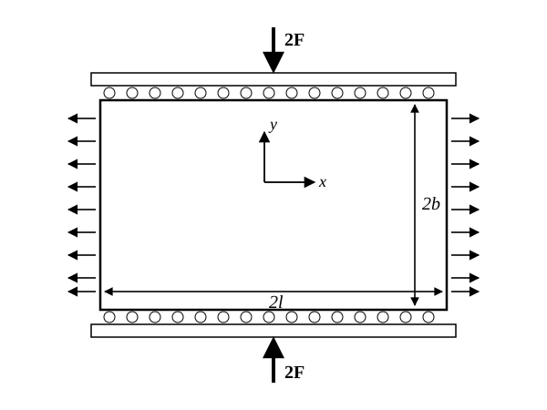

# Mandel's Problem {#benchmark-mandel}

## Consolidation of a poroelastic slab between rigid plates

**Problem Description**

A fluid-saturated poroelastic slab $[-a, a] \times [-b, b]$ in plane strain is squeezed between two
rigid, frictionless and impermeable plates @cite Mandel1953. At $t = 0$, a force $2F$ per unit length
is applied to each plate. The lateral sides $x = \pm a$ are traction-free and drained.
The load is first carried by the pore fluid: the instantaneous (undrained) response raises the pore pressure
uniformly to $p^+$. The fluid then drains through the lateral sides. Because the drained outer part of the slab
softens, load is transferred to the center, where the pore pressure first rises above $p^+$ before it decays
(Mandel-Cryer effect). By symmetry, only the quarter $[0, a] \times [0, b]$ (shaded) is simulated.

{html: width=50%}

The displacement $\mathbf{u}$ and the pore pressure $p$ satisfy the momentum balance and the fluid mass balance

$$\nabla \cdot \left( \boldsymbol{\sigma}' - \alpha p \mathbf{I} \right) = \mathbf{0},
\qquad
\boldsymbol{\sigma}' = 2 G \boldsymbol{\varepsilon} + \lambda \, \mathrm{tr}(\boldsymbol{\varepsilon}) \mathbf{I},
\qquad
\boldsymbol{\varepsilon} = \tfrac{1}{2}\left( \nabla \mathbf{u} + \nabla \mathbf{u}^T \right),$$

$$\frac{\partial \zeta}{\partial t} - \nabla \cdot \left( \frac{k}{\mu} \nabla p \right) = 0,
\qquad
\zeta = \phi + \phi_0 \frac{p - p^+}{K_f},$$

where $\boldsymbol{\sigma}'$ is the effective stress, $G$ and $\lambda$ are the drained Lamé parameters,
$\alpha$ is the Biot coefficient, $k$ is the permeability, $\mu$ is the fluid viscosity and $K_f$ is the
bulk modulus of the fluid. The fluid content $\zeta$ per unit volume of the undeformed slab is the
porosity $\phi$ plus the compression of the pore fluid. The porosity is the pore volume per unit volume
of the undeformed slab @cite Coussy2004,

$$\phi = \phi_0 + \alpha \left( \varepsilon_v - \varepsilon_{v,0} \right) + \frac{p - p^+}{N},
\qquad
\frac{1}{N} = \frac{(\alpha - \phi_0)(1 - \alpha)}{K},$$

with the volumetric strain $\varepsilon_v = \nabla \cdot \mathbf{u}$, the drained bulk modulus $K$,
and the porosity $\phi_0$ and volumetric strain $\varepsilon_{v,0}$ of the undrained state at $t = 0$.
For $\alpha < 1$, the term with $N$ accounts for the compressibility of the solid grains with bulk modulus
$K_s = K/(1-\alpha)$. The fluid content is that of Biot's theory, $\zeta - \phi_0 = \alpha (\varepsilon_v - \varepsilon_{v,0}) + (p - p^+)/M$,
with the Biot modulus $1/M = \phi_0/K_f + 1/N$. The single-phase model solves this linear mass balance with
a constant fluid density and $\zeta$ in place of the porosity in the storage term. A pressure-dependent
density $\varrho_0(1 + p/K_f)$ instead would add terms of relative size $p/K_f$, up to $8 \times 10^{-4}$ here,
which are not part of the analytical solution: with such a density, the convergence rate of the pressure error
in the test below drops from 1.75 (grids $40 \times 4$ to $80 \times 8$) to 0.50 (grids $160 \times 16$ to $320 \times 32$).

Boundary conditions on the quarter domain:

| Boundary | Mechanics | Flow |
|----------|-----------|------|
| $x = 0$ (symmetry) | $u_x = 0$, zero shear traction | no flow |
| $y = 0$ (symmetry) | $u_y = 0$, zero shear traction | no flow |
| $y = b$ (rigid plate) | $u_y$ of the analytical solution, zero shear traction | no flow |
| $x = a$ | traction-free | $p = 0$ |

The rigid plate is represented by its displacement, which is uniform along the plate and follows from the
analytical solution. Initial conditions are the undrained response at $t = 0$,

$$p = p^+ = \frac{F B (1+\nu_u)}{3a},
\qquad
u_x = \frac{F \nu_u}{2 G a} x,
\qquad
u_y = -\frac{F (1-\nu_u)}{2 G a} y,$$

with the Skempton coefficient $B = \alpha M / K_u$, the undrained bulk modulus $K_u = K + \alpha^2 M$
and the undrained Poisson's ratio $\nu_u = (3K_u - 2G)/(2(3K_u + G))$.

**Analytical Solution**

For $t > 0$ @cite Abousleiman1996 @cite Phillips2007,

$$p = 2 p^+ \sum_{n=1}^{\infty} \frac{\sin\beta_n}{\beta_n - \sin\beta_n\cos\beta_n}
\left( \cos\frac{\beta_n x}{a} - \cos\beta_n \right) e^{-\beta_n^2 c t / a^2},$$

$$u_x = \left( \frac{\nu}{2} - \nu_u \sum_{n=1}^{\infty} S_n \right) \frac{F x}{G a}
+ \frac{F}{G} \sum_{n=1}^{\infty} \frac{\cos\beta_n}{\beta_n - \sin\beta_n\cos\beta_n}
\sin\frac{\beta_n x}{a} \, e^{-\beta_n^2 c t / a^2},$$

$$u_y = \left( -\frac{1-\nu}{2} + (1-\nu_u) \sum_{n=1}^{\infty} S_n \right) \frac{F y}{G a},
\qquad
S_n = \frac{\sin\beta_n\cos\beta_n}{\beta_n - \sin\beta_n\cos\beta_n} e^{-\beta_n^2 c t / a^2},$$

where $\nu$ is the drained Poisson's ratio, $\beta_n$ is the $n$-th positive root of
$\tan\beta / \beta = (1-\nu)/(\nu_u-\nu)$, and

$$c = \frac{k}{\mu} M \frac{K + \frac{4}{3} G}{K_u + \frac{4}{3} G}$$

is the consolidation coefficient. The implementation evaluates the first $N_\beta$ terms of each series
(`Problem.NumSeriesTerms`).

**Parameters**

| Parameter | Symbol | Value | Unit |
|-----------|--------|-------|------|
| Force per unit length on each plate | $2F$ | $1.2 \times 10^{9}$ | N/m |
| Half-width, half-height | $a$, $b$ | 100, 10 | m |
| Drained Young's modulus | $E$ | $5.94 \times 10^{9}$ | Pa |
| Drained Poisson's ratio | $\nu$ | 0.2 | - |
| Biot coefficient | $\alpha$ | 1.0 | - |
| Porosity at $t = 0$ | $\phi_0$ | 0.2 | - |
| Fluid bulk modulus | $K_f$ | $3.3 \times 10^{9}$ | Pa |
| Fluid density | $\varrho$ | 1000 | kg/m³ |
| Fluid viscosity | $\mu$ | $10^{-3}$ | Pa s |
| Permeability | $k$ | $9.87 \times 10^{-14}$ | m² |
| Number of series terms | $N_\beta$ | 240 | - |

The derived parameters are $G = 2.475$ GPa, $K = 3.3$ GPa, $M = 16.5$ GPa, $K_u = 19.8$ GPa,
$B = 0.833$, $\nu_u = 0.44$, $c = 0.465$ m²/s, $a^2/c = 21\,493$ s and $p^+ = 2.4$ MPa.
The test `test_md_mandel_compressible_grains` uses $\alpha = 0.7$ and $K_f = 2.2$ GPa instead,
which gives $K_s = 11$ GPa, $M = 7.33$ GPa, $B = 0.745$, $\nu_u = 0.340$ and $p^+ = 2.0$ MPa.

**Setup**

The quarter domain is discretized with a structured grid of $40 \times 4$ cells. The flow problem
(@ref OnePModel) uses the cell-centered two-point flux approximation (@ref CCTpfaDiscretization),
the poroelastic problem (@ref PoroElastic) uses the Box scheme (@ref BoxDiscretization) on the same grid.
The two problems are coupled through the pressure in the effective stress and the porosity in the storage
term, and solved monolithically (@ref MultiDomain) with Newton's method and a direct linear solver.
The time integration uses the multi-stage assembler in `dumux/experimental`; implicit Euler (default),
Crank-Nicolson and a three-stage, third-order diagonally implicit Runge-Kutta method are selected with
`TimeLoop.Scheme`. The time step size starts at `TimeLoop.Dt` and is adapted to the number of Newton
iterations up to `TimeLoop.MaxTimeStepSize`; the solution is written at the times `TimeLoop.CheckPoints`.

**Results**

The plots below are produced by running

```bash
python3 plot_results.py ./test_md_mandel
```

in the build directory `test/multidomain/poromechanics/mandel`. The script runs the simulation until
$t = 20\,000$ s and compares the pressure in the cells and the horizontal displacement of the plate with
the analytical solution. The pressure at the center first rises to $1.081\,p^+$ at $t \approx 1400$ s
(Mandel-Cryer effect) and then decays. The images of this page are regenerated by passing
`doc/doxygen/images` of the DuMux source directory as second argument.


With the parameters above (implicit Euler, time step size growing from 0.1 s to at most 10 s), the
relative discrete $L^2$ error of the pressure at $t = 5000$ s is $3.5 \times 10^{-4}$ for $\alpha = 1$ and
$4.1 \times 10^{-4}$ for $\alpha = 0.7$.

The test `test_md_mandel_convergence` (script `convergencetest.py`) refines the grid twice and checks that the
discrete $L^2$ errors of $p$ and $u_x$ at $t = 1000$ s decrease with a rate of at least 1.9.
It uses the third-order DIRK scheme so that the time discretization error is smaller than the spatial error.
On the grids $40 \times 4$ to $320 \times 32$, the errors are

| Grid | $\lVert p - p_\mathrm{exact} \rVert_{L^2}$ [Pa m] | rate | $\lVert u_x - u_{x,\mathrm{exact}} \rVert_{L^2}$ [m²] | rate |
|------|------|------|------|------|
| $40 \times 4$ | $1.92 \times 10^{4}$ | - | $1.15 \times 10^{-4}$ | - |
| $80 \times 8$ | $4.79 \times 10^{3}$ | 2.00 | $2.87 \times 10^{-5}$ | 2.00 |
| $160 \times 16$ | $1.20 \times 10^{3}$ | 2.00 | $7.17 \times 10^{-6}$ | 2.00 |
| $320 \times 32$ | $2.97 \times 10^{2}$ | 2.01 | $1.79 \times 10^{-6}$ | 2.01 |
